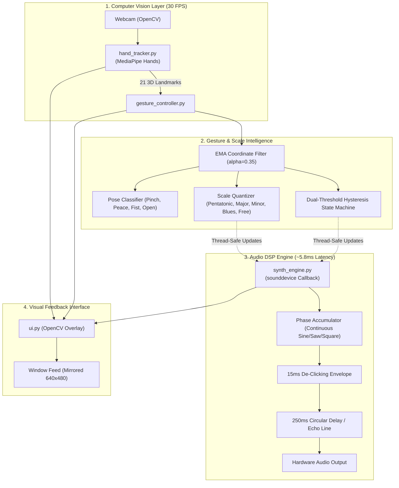

# HandSynth: Real-Time Hand-Gesture Musical Synthesizer

HandSynth is a CPU-first, real-time hand-gesture-controlled musical instrument and synthesizer for Windows 11. It uses **MediaPipe** for 21-landmark perception, **OpenCV** for low-latency video and visual feedback, **NumPy** for digital signal processing (DSP), and **sounddevice** for non-blocking audio streaming.

---

## 1. Quick Navigation
- **Installation & Setup**: See [`SETUP.md`](file:///c:/Users/judea/VsCode/HandSynth/SETUP.md) for step-by-step environment configuration.
- **Controls & Song Tutorials**: See [`HOW_TO_RUN.md`](file:///c:/Users/judea/VsCode/HandSynth/HOW_TO_RUN.md) for hand gesture guides and playing tutorials.

---

## 2. Musical Capabilities & Flexibility

> [!TIP]
> **Can HandSynth play different songs, or is it limited to fixed tunes?**
> HandSynth is a **full-featured, real-time gestural Digital Audio Workstation (DAW)** covering **3 full octaves (C3 to C6: 130.81 Hz to 1046.50 Hz)** with root key transposition, rich musical scales, interactive tone shaping, and arpeggiation. You can play any song, melody, solo, or electronic dance groove!

### Musical Key Selector & Scale Quantizer
- **Root Key Selector (Default: C)**: Transpose into any musical key (`C`, `D`, `E`, `F`, `G`, `A`, `B` plus `# Sharp`).
- **Scale & Tunes Library**:
  - **`PENTATONIC`** *(Default)*: Foolproof pop, Asian folk, and beginner melodies (impossible to hit a bad note!).
  - **`BLUES`**: Rock solos, blues riffs, and expressive bends.
  - **`MAJOR`**: Cheerful classical songs ("Twinkle Twinkle", "Ode to Joy"), pop anthems.
  - **`MINOR`**: Emotional, dark, cinematic themes and hip-hop leads.
  - **`DORIAN`**: Daft Punk / funk / modal jazz groove.
  - **`HIRAJOSHI`**: Traditional Japanese koto / anime / zen melodies.
  - **`CHROMATIC`**: Full 12-semitone piano keyboard.
  - **`FREE`**: Continuous fretless Theremin glide with natural wrist vibrato.

---

## 3. Gestures & Controls

HandSynth recognizes both **continuous spatial tracking** and **discrete hand poses**:

| # | Gesture Name | Trigger Condition | Function / Effect |
| :- | :--- | :--- | :--- |
| **1** | **Horizontal Glide** | Hand $X$ across screen ($0.15 \leftrightarrow 0.85$) | **Continuous Pitch / Note Selection** across C3 - C6. |
| **2** | **Vertical Elevation** | Hand $Y$ height on screen | **Continuous Volume Modulation** (Up = 100%, Down = 0%). |
| **3** | **Thumb-Index Pinch** | Euclidean distance $d < 0.045$ | **Note-On Trigger** (starts sounding with 15 ms soft attack). |
| **4** | **Pinch Release** | Euclidean distance $d > 0.070$ | **Note-Off Release** (smooth fade-out to silence; no clicks). |
| **5** | **Peace / V-Sign** | Index + Middle extended, others curled | **+1 Octave Transpose** (+12 semitones boost instantly). |
| **6** | **Fist Pose** | All 4 fingers curled into palm | **Emergency Choke / Mute** (silences any ringing note immediately). |
| **7** | **Open Palm** | All fingers spread | Standard expression and hover mode. |
| **8** | **Hand Disappearance** | Hand leaves webcam frame | **Automatic Failsafe**: Cuts audio stream to prevent hanging notes. |

---

## 4. Multi-Instrument Sound Engine & Audio Effects

HandSynth features 4 distinct synthesized waveforms, a real-time tone filter, delay echo, and an arpeggiator:

- **`[1] SINE WAVE`**: Pure fundamental frequency with zero harmonic distortion. Smooth and flute-like.
- **`[2] SAWTOOTH WAVE`**: Rich in odd and even harmonics ($y = 2 \cdot (\phi/2\pi - \lfloor\phi/2\pi + 0.5\rfloor)$). Brassy, cutting EDM lead.
- **`[3] SQUARE WAVE`**: Rich in odd harmonics ($y = \text{sign}(\sin(\phi))$). Hollow 8-bit chiptune / organ pulse.
- **`[4] TRIANGLE WAVE`**: Warm, gentle odd harmonics. Rhodes electric piano / mellow acoustic vibe.
- **`TONE / CUTOFF FILTER`**: Interactive 1-pole Low-Pass Filter ($150\text{ Hz} \leftrightarrow 14,000\text{ Hz}$). Shifts from **Warm Sub** to **Bright Sizzle**.
- **`[E] DELAY / ECHO EFFECT`**: 250 ms circular delay buffer with 40% feedback and 35% wet mix for spatial reverberation.
- **`[A] ARPEGGIATOR`**: 120 BPM rhythmic note stepper (`OFF` $\rightarrow$ `UP` $\rightarrow$ `BOUNCE`) that arpeggiates chords while holding a note.

---

## 5. System Architecture



---

## 6. Project Files Overview

| File | Purpose |
| :--- | :--- |
| [`main.py`](file:///c:/Users/judea/VsCode/HandSynth/main.py) | Application coordinator: webcam loop, module linking, hotkeys, and graceful teardown. |
| [`hand_tracker.py`](file:///c:/Users/judea/VsCode/HandSynth/hand_tracker.py) | Encapsulates MediaPipe Hands with horizontal mirror mode and CPU optimizations. |
| [`gesture_controller.py`](file:///c:/Users/judea/VsCode/HandSynth/gesture_controller.py) | Interprets 21 landmarks into pitch, volume, pinch hysteresis, and discrete gestures. |
| [`synth_engine.py`](file:///c:/Users/judea/VsCode/HandSynth/synth_engine.py) | Thread-safe, non-blocking digital signal processor with 3 instruments and Echo effect. |
| [`ui.py`](file:///c:/Users/judea/VsCode/HandSynth/ui.py) | Real-time heads-up display rendering note name, pitch ribbon, volume meter, and badges. |
| [`SETUP.md`](file:///c:/Users/judea/VsCode/HandSynth/SETUP.md) | Comprehensive installation, environment, and troubleshooting guide. |
| [`HOW_TO_RUN.md`](file:///c:/Users/judea/VsCode/HandSynth/HOW_TO_RUN.md) | Playing tutorials, gesture guide, scale instructions, and presentation demo steps. |
| [`test_audio.py`](file:///c:/Users/judea/VsCode/HandSynth/test_audio.py) | Standalone test for audio playback, pitch slide, and click-free fade. |
| [`test_milestone4.py`](file:///c:/Users/judea/VsCode/HandSynth/test_milestone4.py) | Standalone test for pitch curve, volume mapping, hysteresis, and safety releases. |
| [`test_final.py`](file:///c:/Users/judea/VsCode/HandSynth/test_final.py) | Full stability audit suite for multi-waveform DSP, circular delay, and concurrency. |

---

## 7. How to Launch & Verify

### Launch HandSynth
```powershell
.\.venv\Scripts\python.exe main.py
```

### Run Full Test Verification
```powershell
.\.venv\Scripts\python.exe test_final.py
```
*(All 5 audit tests pass with 0 errors on Windows 11).*

---

## 8. Academic AI Assessment

- **Perception Layer**: Employs deep learning (MediaPipe BlazePalm detector + 2.5D hand joint regression CNN).
- **Synthesis Layer**: Built upon mathematical geometry and digital signal processing formulas.
- **For Academic Grading**: To satisfy academic requirements that demand custom model training, consider implementing a custom gesture chord classifier (e.g., Random Forest or 1D-CNN) trained on your own recorded landmark datasets with a confusion matrix.
